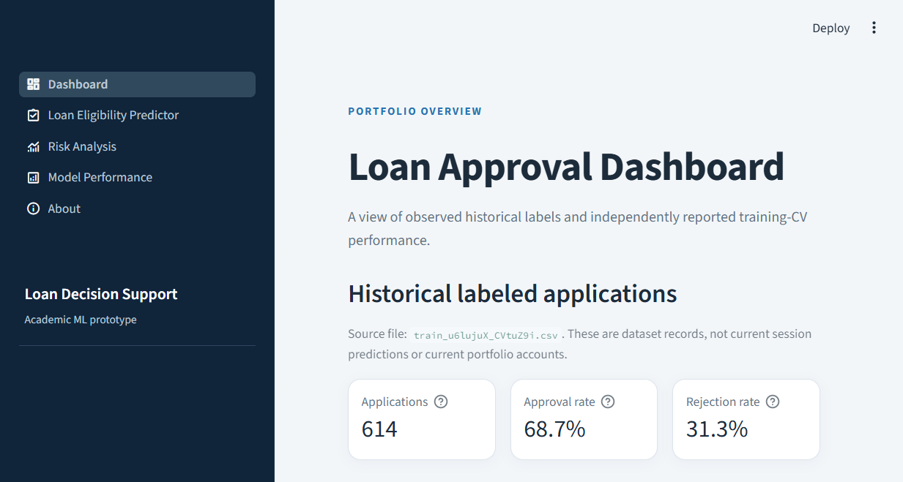
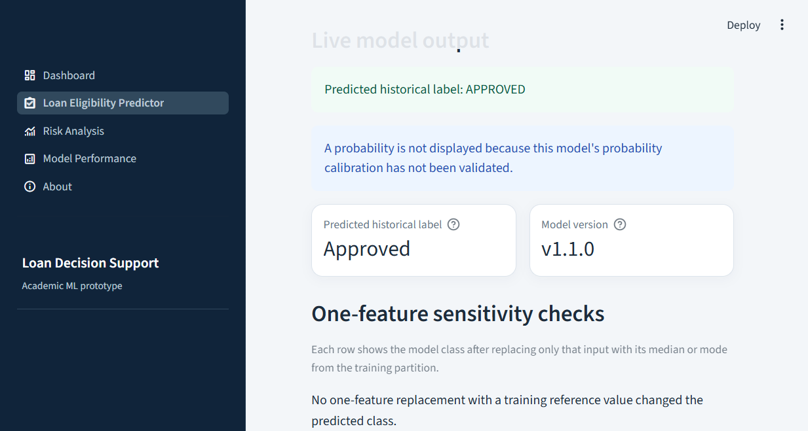
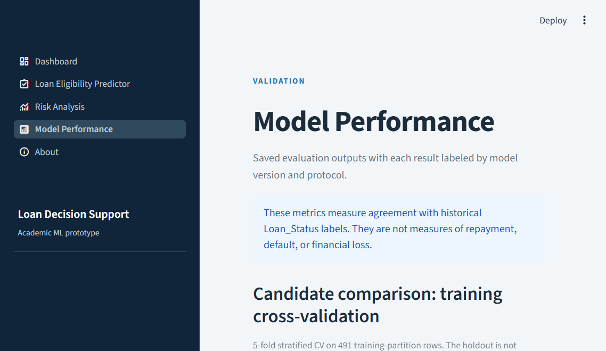
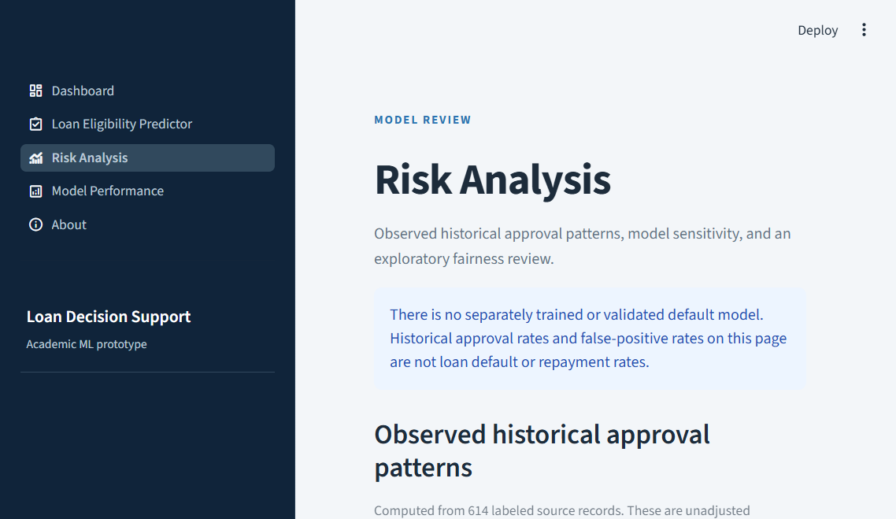

# Intelligent Loan Approval & Credit Risk Prediction System

An academic, reproducible machine-learning decision-support prototype with
two separate models: a historical `Loan_Status` approval classifier and an
independent LendingClub repayment-outcome default-risk classifier. Neither is
an autonomous lending decision engine. A third, independent rule-based Lending
Decision Engine provides configurable policy-driven approval routing (approve
/ reject / refer for manual review) and is not connected to either ML model.

## Project overview

### Problem statement

The project distinguishes historical approval outcomes from subsequent loan
performance. The approval model classifies a public dataset's `Loan_Status`
label. The separate default-risk model uses matured LendingClub records
labeled `Charged Off` or `Fully Paid`, with unresolved outcomes excluded.

### Objectives

- Keep labeled training data separate from the Kaggle file without labels.
- Audit and profile the input data without modifying the source CSVs.
- Build reusable, fold-local preprocessing and feature engineering.
- Compare four classifiers using the same stratified cross-validation folds.
- Tune the selected candidate using training data only.
- Record evaluation provenance and version complete model pipelines.
- Explain model behavior and show the actual measured outputs in Streamlit.
- Exercise the system with unit, integration, and validation tests.

The approval module target is historical `Loan_Status`. The separate
LendingClub module estimates a historical default outcome among loans with
resolved labels. Neither output is a regulated credit rating, a guarantee of
future performance, or a recommendation to approve a loan.

## Scope and Limitations

The approval model estimates whether an application resembles records
historically labeled approved (`Y`) or rejected (`N`). It does not predict
repayment, default, creditworthiness, or whether a real lender should approve
an application.

The separate LendingClub model uses exact `Charged Off` versus `Fully Paid`
outcomes. It excludes loans that are current, late, in a grace period, or
otherwise unresolved. Because this snapshot does not establish a common
observation horizon or resolve all loans, its default estimate is conditional
on the dataset's resolved-label subset; it is not a verified fixed-horizon
default-incidence estimate. It is not evidence of future individual
performance or suitable for real credit decisions without independent
validation, governance, and applicable legal review.

Feature importance indicates predictive contribution within the corresponding
dataset, not causation. Risk categories in the default-risk module are
configurable academic display bands, not universal banking standards.

This output is an estimate of historical Loan_Status (approved/rejected), not default probability, repayment likelihood, a credit score, or a lending decision.

## Default-risk module

The independent module uses the user-provided LendingClub accepted-loan
archive, [dataset source](https://www.kaggle.com/datasets/wordsforthewise/lending-club).
See [dataset acquisition and audit notes](docs/default_risk/dataset_acquisition.md),
[the generated dataset audit](reports/default_risk/lendingclub_dataset_audit.md),
and [feature eligibility policy](reports/default_risk/feature_eligibility.md).

The 151-column archive contains 2,260,701 records (including 33 trailing
summary rows), 1,076,751 exact `Fully Paid` labels and 268,559 exact
`Charged Off` labels. Other statuses are excluded, never mapped to either
class. The module uses a chronological holdout beginning in 2016, training-only
expanding time-series cross-validation, fold-local preprocessing, and
training-only calibration. See the [measured comparison and holdout report](reports/default_risk/model_evaluation.md)
and [calibration report](reports/default_risk/calibration_report.md) for
actual metrics.

Train or recreate the independent model from the project root:

```powershell
.\env\Scripts\python.exe -m default_risk.train `
  --test-start-year 2016 `
  --max-train-rows 100000 `
  --max-test-rows 40000 `
  --cv-folds 3 `
  --random-state 42
```

The model uses a deterministic sample of up to 100,000 earlier-cohort rows
for development and up to 40,000 later-cohort rows for final evaluation. Full
eligible rows are written to the ignored `data/default_risk/processed/`
directory; the report records the actual sample sizes. The model artifact and
metadata are registered separately under
`artifacts/models/default_risk/`.

The Streamlit page is **Loan Default Risk Prediction**. It is separate from
the historical approval predictor and displays a dedicated disclaimer. To
start the app:

```powershell
.\env\Scripts\python.exe -m streamlit run app.py
```

## Lending Decision Engine

The Lending Decision Engine is an independent, rule-based decision-support
page (`lending_decision_engine`) registered in `app/main.py` at
`url_path="lending-decision-engine"`. It is separate from both ML models and
implements policy-driven routing without any learned inference.

### Overview

The engine reads configurable lending policy thresholds from
`config/lending_policy.yaml`, evaluates each application against those rules,
and returns one of three outcomes: **APPROVE**, **REJECT**, or **REFER FOR
MANUAL REVIEW**. Every decision is recorded in persistent decision history
and can be audited through the Streamlit UI.

### Source modules

All business logic lives under `src/decision_engine/`:

| Module | Key functions / classes | Purpose |
|--------|------------------------|---------|
| `engine.py` | `DecisionEngine` | Core rule evaluation; applies policy thresholds to applications |
| `policy_loader.py` | `load_lending_policy` | Loads policy configuration from YAML |
| `policy_validator.py` | `validate_lending_policy` | Validates policy structure and threshold ranges |
| `decision_history.py` | `record_decision`, `get_all_decisions`, `get_decision_counts`, `filter_decisions` | Persistent storage and retrieval of decision records |
| `explanations.py` | `format_currency`, `format_percent`, `report_to_dict` | Human-readable formatting and report serialization |
| `schemas.py` | `DecisionOutcome` | Typed schema for decision results |

### Page tabs (`app/pages/lending_decision_engine.py`)

The Streamlit page exposes five tabs:

- **Dashboard** — Shows decision counts by outcome and the active policy version.
- **New Application** — Renders `st.form("lending_decision_form")` to collect application data, runs the engine, and displays the decision report with financial metrics, risk assessment, rule evaluation, warnings, and manual review reasons.
- **Decision History** — Lists all recorded decisions with filtering by decision type and application ID.
- **Manual Review** — Shows `REFER FOR MANUAL REVIEW` decisions with reviewer status and notes.
- **Policy Management** — Displays the active policy version, status, and configured thresholds.

### Decision flow

1. User submits an application form with personal, financial, and loan details.
2. `_cached_engine()` (cached via `@st.cache_resource`) instantiates
   `DecisionEngine(project_root=PROJECT_ROOT)` once and reuses it across tabs.
3. The engine evaluates the application against the loaded policy thresholds.
4. The decision outcome (`APPROVE` / `REJECT` / `REFER`) is recorded via
   `record_decision()` and rendered in `_render_decision_report()`.
5. Manual-review decisions appear in the Manual Review tab for reviewer
   disposition.

### Important notes

- The engine is rule-based only; it does not invoke either ML model.
- Policy thresholds in `config/lending_policy.yaml` are illustrative
  development values and must be replaced with institution-approved values
  before any production use. Changes require an application restart.
- Manual review override persistence in `decision_history.py` is an
  outstanding work item: reviewer dispositions are currently shown in UI
  state but not yet wired to persistent storage.

## Dataset and source

Source: [Kaggle Loan Prediction Problem Dataset](https://www.kaggle.com/datasets/altruistdelhite04/loan-prediction-problem-dataset).
See [dataset acquisition notes](docs/dataset_source.md). The dataset license
and reuse terms have not been independently verified; consult Kaggle before
redistribution.

The acquisition has two distinct files:

| File | Rows | Columns | Role |
|---|---:|---:|---|
| `train_u6lujuX_CVtuZ9i.csv` | 614 | 13 | Labeled applications, including `Loan_Status` |
| `test_Y3wMUE5_7gLdaTN.csv` | 367 | 12 | Unlabeled applications; never merged into training data |

The labeled target distribution is 422 approvals (`Y`, 68.73%) and 192
rejections (`N`, 31.27%). There are no duplicate rows, duplicate IDs, invalid
target labels, or cross-file ID overlaps in the audited files. The labeled
data has 50 missing `Credit_History` values (8.14%); other fields also contain
missing values. Full field-level counts and the read-only quality audit are
available in [the data-quality report](reports/data_quality_report.md) and
[the dataset profile](artifacts/reports/dataset_profile.json).

The CSVs are intentionally excluded from version control. Obtain the dataset
from Kaggle and place the two files in `data/raw/` using the exact names above.
No Kaggle credentials or download tokens are required by the loader.

## Data cleaning and preprocessing

The quality audit does not delete records, impute values, or rewrite source
files. It distinguishes domain violations from unusual but potentially valid
observations; IQR flags are descriptive and do not automatically exclude
applicants. No invalid categories, negative configured numeric values, or
non-finite values were found in the acquired CSVs.

For modeling:

1. The target and identifier `Loan_ID` are excluded from model features.
2. The labeled rows are split with stratification before fitting any learned
   transformation (configured holdout fraction 20%, seed 42).
3. Each CV fold fits its own complete pipeline using median numeric
   imputation and scaling, categorical most-frequent imputation, and
   `OneHotEncoder(handle_unknown="ignore")`.
4. Prediction-time validation requires exactly the configured 11 raw fields.
   Optional form values can be missing and pass through the same fitted
   pipeline. Unsupported categories are rejected by the form service; the
   underlying encoder itself ignores unseen categories.
5. Class weighting / per-fit balanced sample weights are used rather than
   pre-split oversampling.

## Exploratory data analysis

The EDA notebook reports numerical statistics, categorical distributions,
income and loan amount distributions, loan term, credit history, employment
status, approval/rejection counts, missingness, and numeric correlations. It
used all 614 labeled source rows before the train/holdout split, including the
123 rows later assigned to the holdout; therefore the holdout is not an
independent confirmation set. It writes charts to `plots/`. The
observed association between credit-history group and historical approval is
large (79.58% for value `1`; 7.87% for value `0`). Historical approval rates
were 61.45% for Rural, 76.82% for Semiurban, and 65.84% for Urban
applications. Applicant income medians were 3,833.5 for rejected and 3,812.5
for approved records; loan amount medians were 129 and 126, respectively.
These are sample summaries, not causal effects. Full context and the
retrospective holdout disclosure are in [EDA insights](reports/eda_insights.md).

## Feature engineering

`LoanFeatureEngineer` is applied inside the full training and inference
pipeline. It creates:

- `Total_Income = ApplicantIncome + CoapplicantIncome`
- `Loan_to_Income_Ratio = LoanAmount / Total_Income`, when total income is
  positive and loan amount is nonnegative
- Configured `log1p` features for nonnegative income and loan measurements

Zero denominators, missing/non-numeric values, negative log inputs, and
non-finite arithmetic are handled as missing values for subsequent
training-fold imputation. Extreme finite source values are not clipped using
arbitrary limits. **Loan-to-income ratio is not actual debt-to-income (DTI)**:
the dataset does not include other debt obligations. More detail:
[feature engineering report](reports/feature_engineering_report.md).

## Algorithms and measured comparison

The candidate classifiers are Logistic Regression, Decision Tree, Random
Forest, and Gradient Boosting. Candidate comparison uses 5-fold stratified
CV on the 491-row training partition. Selection was by mean balanced accuracy,
with mean ROC-AUC as a tie-breaker. The measured candidate CV means ± fold
standard deviations are:

| Candidate | Accuracy | Balanced accuracy | ROC-AUC | Specificity | Precision (Y) | Recall (Y) | F1 (Y) |
|---|---:|---:|---:|---:|---:|---:|---:|
| Logistic Regression | 0.723 ± 0.068 | 0.679 ± 0.074 | 0.743 ± 0.092 | 0.558 ± 0.117 | 0.799 ± 0.044 | 0.799 ± 0.079 | 0.797 ± 0.054 |
| Decision Tree | 0.656 ± 0.060 | 0.631 ± 0.064 | 0.648 ± 0.076 | 0.565 ± 0.147 | 0.781 ± 0.047 | 0.697 ± 0.099 | 0.733 ± 0.058 |
| Random Forest | 0.745 ± 0.061 | **0.684 ± 0.082** | **0.779 ± 0.072** | 0.520 ± 0.168 | 0.798 ± 0.052 | 0.849 ± 0.068 | 0.821 ± 0.042 |
| Gradient Boosting | **0.768 ± 0.068** | 0.681 ± 0.088 | 0.734 ± 0.110 | 0.448 ± 0.153 | 0.785 ± 0.049 | **0.914 ± 0.054** | **0.844 ± 0.044** |

The selected baseline was Random Forest v1.0.0. Training-only randomized
search produced tuned Random Forest v1.1.0: balanced accuracy **0.6928 ±
0.0635** and ROC-AUC **0.7828 ± 0.0601**, compared with baseline CV values
0.6845 ± 0.0824 and 0.7787 ± 0.0724 on the same folds. The +0.0083 balanced
accuracy difference is modest and not evidence by itself of a practically
meaningful improvement.

### Holdout results — baseline v1.0.0 only

The 123-row holdout results belong to **Random Forest v1.0.0**, before
hyperparameter tuning:

| Metric | Holdout result |
|---|---:|
| Accuracy | 0.8618 |
| Balanced accuracy | 0.8491 |
| Precision (Y) | 0.9146 |
| Recall (Y) | 0.8824 |
| F1 (Y) | 0.8982 |
| ROC-AUC | 0.8672 |
| Specificity | 0.8158 |

Do not attribute those holdout results to tuned v1.1.0: the tuned model has
only the documented training CV results and has not been evaluated on the
holdout. The 123-row baseline holdout was already evaluated, and its observations were
included in full-dataset EDA before the split. It is not an untouched,
independent estimate and must not be used for future model selection. All
metrics measure agreement with historical labels, not lending outcomes. See
the [evaluation report](reports/evaluation_report.md)
and [hyperparameter tuning report](reports/hyperparameter_tuning_report.md).

## Explainability and limitations

Training-fold permutation importance ranked `Credit_History` highest (mean
balanced-accuracy decrease 0.1823, SD 0.0670), followed by `ApplicantIncome`
(0.0346), `LoanAmount` (0.0342), and `CoapplicantIncome` (0.0309). The
explanations describe model behavior, not causes or policy importance.
One-feature sensitivity checks can create unrealistic applicant profiles.
SHAP was not run because its optional package is not installed; no SHAP values
are claimed.

The dataset is small, historical, and has no repayment/default outcomes. Its
recorded decisions may encode past practices. The available subgroup analysis
is limited and does not establish fairness or absence of discrimination.
There is no probability calibration, operational validation, or legal review.
Human assessment and independent validation are necessary before any real-world
use; this academic prototype should not make or automate lending decisions.

## Future improvements

- Obtain permissioned, representative data with observed repayment,
  delinquency, and default outcomes, and define a separate outcome-specific
  modeling problem.
- Validate on a later time period and independent institutions/populations;
  preserve a genuinely untouched evaluation cohort for each model release.
- If probability use is justified, calibrate on training-only validation data
  and document threshold trade-offs without using a final test set for tuning.
- Expand data quality, missingness, subgroup, and intersectional fairness
  studies with adequate group sizes and domain/legal review.
- Add model monitoring, drift checks, versioned retraining controls, and
  decision/audit governance before any operational deployment.
- Run SHAP only in a compatible, pinned environment and verify explanations
  against the complete pipeline before presenting them.

## Application screenshots

The Streamlit app includes Dashboard, Loan Eligibility Predictor, Risk
Analysis, Model Performance, About, and Lending Decision Engine pages.
Dashboard historical counts are kept separate from session predictions. The
predictor uses the registered complete v1.1.0 pipeline and displays only a
predicted class because probability calibration is not validated. The Lending
Decision Engine page is rule-based and separate from both ML models.

| Dashboard | Predictor |
|---|---|
|  |  |

| Model performance | Risk analysis |
|---|---|
|  |  |

## Project structure

```text
.
├── app.py
├── config.yaml
├── pyproject.toml
├── requirements.txt
├── data/
│   ├── raw/                 # Local Kaggle CSVs; ignored by Git
│   ├── processed/
│   └── external/
├── notebooks/
│   ├── 01_data_analysis.ipynb
│   └── 03_model_training.ipynb
├── src/
│   ├── config/                 # Settings, validation, resolved paths
│   ├── data/                   # Loading, validation, profiling, split
│   ├── features/               # Deterministic feature engineering
│   ├── preprocessing/          # Fold-fitted ColumnTransformer/Pipeline
│   ├── models/                     # Classifiers, training, tuning, registry
│   ├── decision_engine/            # Rule-based lending decision engine
│   │   ├── engine.py               # DecisionEngine core rule evaluation
│   │   ├── policy_loader.py        # load_lending_policy
│   │   ├── policy_validator.py     # validate_lending_policy
│   │   ├── decision_history.py     # record_decision, get_all_decisions, etc.
│   │   ├── explanations.py         # format_currency, format_percent, report_to_dict
│   │   └── schemas.py              # DecisionOutcome schema
│   ├── evaluation/
│   ├── explainability/
│   ├── prediction/
│   └── utils/
├── app/
│   ├── pages/
│   │   ├── lending_decision_engine.py  # Lending Decision Engine page (5 tabs)
│   ├── components/
│   └── services/            # UI-independent dashboard/prediction logic
├── artifacts/
│   ├── models/              # Local model files; ignored by Git
│   └── reports/
├── reports/                 # Measured reports
├── plots/                   # Generated visualization images (charts, figures)
├── docs/                    # Architecture, data dictionary, model card, QA
└── tests/
    ├── unit/
    ├── integration/
    └── validation/
```

## Installation

### 🔧 Setup Guide for Collaborators (clean, reproducible)

The repository contains only source code (~14 MB). Datasets and trained model
artifacts are **not** included and must be obtained/generated locally before
the app will function fully.

Follow these steps after cloning:

#### 1. Clone the repository

```powershell
git clone https://github.com/Elcapo-ops/IntelligentLoanApproval-RiskPredictionSystem_AlchemistDigitalSolution.git
cd IntelligentLoanApproval-RiskPredictionSystem_AlchemistDigitalSolution
```

#### 2. Create a virtual environment

```powershell
py -3.14 -m venv .venv
.\.venv\Scripts\Activate.ps1
```

On macOS/Linux:

```bash
python3 -m venv .venv
source .venv/bin/activate
```

#### 3. Install dependencies

```powershell
python -m pip install --upgrade pip
python -m pip install -r requirements.txt
python -m pip install -e .
python -m pip check
```

### you can find the trained models by following this link
https://drive.google.com/drive/folders/15c08gm0BRC4WUC7Z20gjRTY0fw5VSQ7x?usp=sharing


#### 4. Or you can Download datasets (must be done manually)

The two Kaggle CSVs and the LendingClub archive are **git-ignored** and are
not in the repository. Download each dataset from the links below and place
them in the destination folder.

| File | Download link | Destination |
|------|---------------|-------------|
| `train_u6lujuX_CVtuZ9i.csv` | [Kaggle Loan Prediction Problem Dataset](https://www.kaggle.com/datasets/altruistdelhite04/loan-prediction-problem-dataset) | `data/raw/train_u6lujuX_CVtuZ9i.csv` |
| `test_Y3wMUE5_7gLdaTN.csv` | [Kaggle Loan Prediction Problem Dataset](https://www.kaggle.com/datasets/altruistdelhite04/loan-prediction-problem-dataset) | `data/raw/test_Y3wMUE5_7gLdaTN.csv` |
| LendingClub accepted-loan archive | [Kaggle LendingClub](https://www.kaggle.com/datasets/wordsforthewise/lending-club) | `data/external/` |

**Note:** You must have a Kaggle account to download from Kaggle. Log in at [kaggle.com](https://www.kaggle.com), open the dataset page, and click **Download**. No Kaggle API credentials or tokens are required by the loader — just copy the downloaded files into the folders above.

#### 5. Train all models from datasets

Run the unified training script from the project root:

```powershell
python scripts/train_all_models.py
```

This trains both models:
- **Historical Loan_Status approval classifier** from `data/raw/`
- **Independent LendingClub default-risk classifier** from `data/external/`

Model artifacts are written to `artifacts/models/` (git-ignored).
Reports are written to `reports/` and `plots/`.

You can skip one model if needed:

```powershell
# Skip default-risk training
python scripts/train_all_models.py --skip-default-risk

# Skip approval training
python scripts/train_all_models.py --skip-approval
```
#### 6. Run the app

```powershell
streamlit run app.py
```

Or via Python module:

```powershell
python -m streamlit run app.py
```

Open `http://localhost:8501` in your browser.

---

### Testing

Run the unit, integration, and validation suite:

```powershell
python -m pytest -q
```

Run with application/source line coverage:

```powershell
python -m pytest --cov=app --cov=src --cov-report=term-missing -q
```

Dataset-dependent validation and end-to-end integration checks are skipped
when the git-ignored Kaggle CSVs are absent; unit tests still exercise the
missing-file errors.

---

### Reproducibility notes

- Model artifacts and raw datasets are local, git-ignored files. For a fresh
  checkout, provide the dataset and reproduce the registered model artifacts
  before using the predictor.
- Only load model files from a trusted local registry; Joblib/pickle artifacts
  are executable serialization formats.
- Python 3.12+ required (tested with 3.14.5 on Windows).

## Execution and reproduction

From the project root:

```powershell
python -m streamlit run app.py
```

To reproduce the notebooks, install Jupyter/IPykernel from the pinned
requirements, open `notebooks/01_data_analysis.ipynb` or
`notebooks/03_model_training.ipynb`, and run cells top-to-bottom. The EDA
notebook uses labeled training data only. The training notebook performs
training-partition CV and saves registered candidate pipelines; it reserves
the holdout. Evaluation and model tuning reports refer to their documented
saved outputs and protocols; do not treat rerunning holdout evaluation as a
new independent test.

The Python workflow APIs are `models.train.train_models`,
`evaluation.evaluate.evaluate_selected_model`, and
`models.optimize.optimize_selected_model`. They consume the labeled
DataFrame, validated config, and configured artifact/report paths; see the
training notebook and phase reports for the executed settings. Run evaluation
on the baseline holdout only as a final evaluation and do not use its result
to tune or select a model. Tuning is training-CV-only and does not provide a
holdout score for v1.1.0.

Model artifacts and raw datasets are local, git-ignored files. For a fresh
checkout, provide the dataset and reproduce the registered model artifacts
before using the predictor. Only load model files from a trusted local
registry; Joblib/pickle artifacts are executable serialization formats.

## Testing

Run the unit, integration, and validation suite:

```powershell
python -m pytest -q
```

Run with application/source line coverage:

```powershell
python -m pytest --cov=app --cov=src --cov-report=term-missing -q
```

Dataset-dependent validation and end-to-end integration checks are skipped
when the git-ignored Kaggle CSVs are absent; unit tests still exercise the
missing-file errors. The Lending Decision Engine has 27 dedicated tests
(27/27 passing) covering rule evaluation, policy loading/validation, and
decision history functions. The last delivery run and measured coverage are in
[docs/testing_report.md](docs/testing_report.md) and
[reports/phase_8_2_qa_report.md](reports/phase_8_2_qa_report.md).

## Configuration and references

`config.yaml` centralizes paths, feature schema/domains, random seed, split,
CV, model parameters, tuning, logging, and Streamlit settings. Relative paths
resolve from the project root, not the current working directory.

- [Architecture](docs/architecture.md)
- [Data dictionary](docs/data_dictionary.md)
- [Model card](docs/model_card.md)
- [Testing and delivery verification](docs/testing_report.md)
- [Final delivery checklist](docs/delivery_checklist.md)
- [Final audit report](reports/final_audit_report.md)
- [Requirements compliance matrix](reports/requirements_compliance.csv)
- [Leakage audit](reports/leakage_audit.md)
- [Model validation report](reports/model_validation_report.md)
- [Final audit test report](reports/final_test_report.md)
- [Audited architecture](docs/final_architecture.md)
- [Dataset source and acquisition](docs/dataset_source.md)
- [Data-quality audit](reports/data_quality_report.md)
- [EDA findings](reports/eda_insights.md)
- [Feature-engineering details](reports/feature_engineering_report.md)
- [Model training results](reports/model_training_report.md)
- [Evaluation report](reports/evaluation_report.md)
- [Explainability report](reports/explainability_report.md)
- [Business insights and limitations](reports/business_insights.md)
- Lending policy configuration: `config/lending_policy.yaml`
# IntelligentLoanApproval-RiskPredictionSystem_AlchemistDigitalSolution
Academic ML prototype for loan approval prediction and credit risk assessment — featuring a historical Loan_Status classifier, an independent LendingClub default-risk model, and a rule-based Lending Decision Engine with Streamlit UI. Not for production lending decisions.
